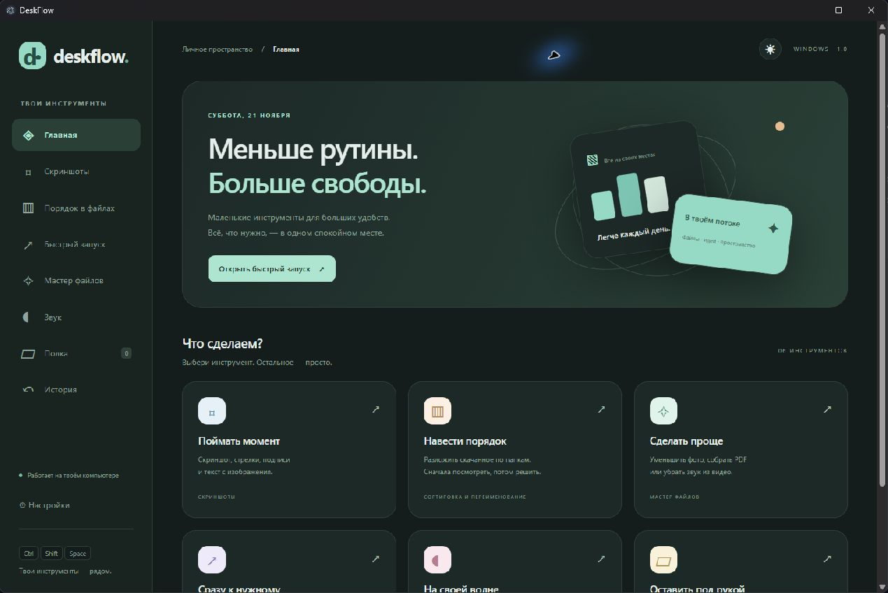

# DeskFlow

Локальные инструменты Windows: скриншоты, OCR, работа с файлами, звук и быстрый запуск.

Личный проект в развитии, созданный с помощью ИИ. Первая публикация предлагается как **предварительный релиз**, без обещания работы на всех устройствах.



Изображение интерфейса версии 1.0; в публичной 1.0.1 добавлена отдельная настройка FFmpeg.

## Скачать приложение

Откройте [Releases](https://github.com/Xirikai/deskflow/releases) и скачайте **DeskFlow-Windows-v1.0.1.zip**. Распакуйте ZIP и запустите EXE внутри; Node.js пользователю не нужен.

GitHub-файлы **Source code** — исходники для разработки, готовое приложение находится в ZIP с названием платформы. Ссылки начнут работать после первой публикации репозитория и релиза.

## Возможности

- Снимки экрана, редактор и локальное распознавание текста Windows.
- Сортировка и массовое переименование с предпросмотром, историей и отменой.
- Преобразование изображений, фото в PDF, удаление звука из видео через внешний FFmpeg.
- Поиск установленных программ и собственные ярлыки.
- Громкость устройств и активных программ, звуковые профили.
- Полка с локальными копиями файлов, текстом и ссылками.
- Светлая, тёмная и системная темы.

## Запуск из исходников

Нужен Node.js 22+ и Windows 10/11 x64 с .NET Framework 4.

```powershell
npm ci
npm run setup
npm start
```

Если npm не выполнил установочный скрипт Electron автоматически, команда `npm run setup` загрузит официальный runtime.

## Сборка Windows

```powershell
npm run build
```

Результат появляется в `release/`. Аудиопомощник компилируется из `native/Audio.cs`; NAudio 1.10.0 скачивается из NuGet и проверяется по SHA-256. FFmpeg не входит в сборку — см. [подключение видео](docs/FFMPEG.md).

## Проверки

```powershell
npm test
```

14 автоматических проверок, включая изображения, PDF, операции с файлами, отмену и видео с внешним FFmpeg. Чистая установка зависимостей и компиляция C#-помощника из проверенного пакета NuGet прошли.

В репозитории предусмотрены автоматические проверки GitHub Actions. Они начнут выполняться после публикации. Локальная проверка не означает успешный запуск ещё не выполненного CI.

## Данные и ограничения

Только Windows 10/11 x64. FFmpeg для видеомодуля устанавливается отдельно. OCR зависит от языковых компонентов Windows. Звуковые устройства, удерживаемые другими программами, могут требовать перезапуска воспроизведения. EXE без сертификата цифровой подписи; автоматических обновлений нет.

Настройки, история и копии полки находятся в `%APPDATA%/DeskFlow`. Резервную копию этой папки создают при полностью закрытом приложении. Исходные файлы при добавлении на полку остаются на месте.

## Как создавался проект

Автор выбирал функции, проверял сценарии использования, находил неудобства и уточнял требования. ИИ подготовил значительную часть кода, документации и технических решений. Это первый практический опыт создания приложения; самостоятельное знание всех используемых технологий не заявляется.

## Обратная связь

В Issues опишите действия, ожидаемый и фактический результат, версию приложения и Windows/Android. Не прикладывайте личные резервные копии, пароли или ключи.

## Лицензии

Новый код проекта — [MIT](LICENSE). У сторонних компонентов собственные лицензии: [THIRD-PARTY.md](THIRD-PARTY.md), тексты в `licenses/`. Версии зависимостей закреплены в `package-lock.json`.
